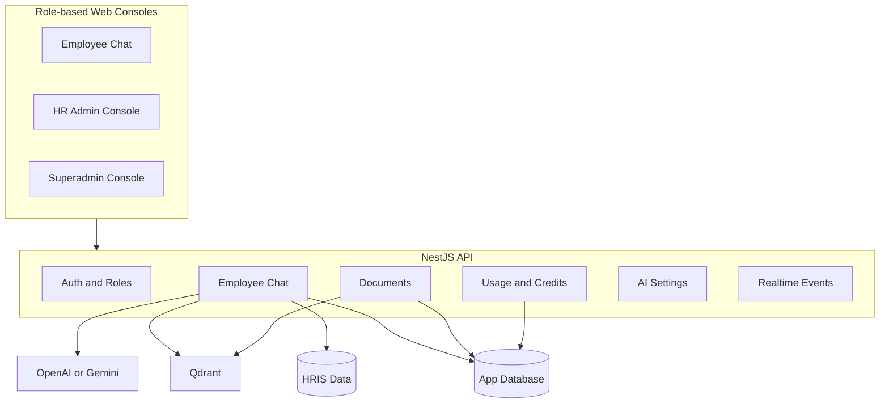
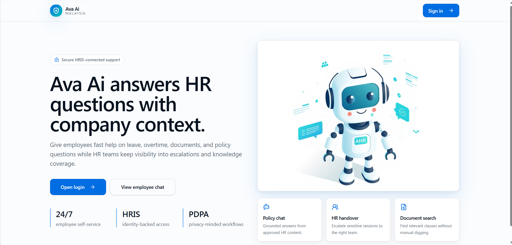

[Back to README](../README.md)

# 01 Executive Summary

## Overview

Ava AI is an AI-powered HR assistant platform for employees, HR teams, and superadmins. It helps employees ask HR questions in natural language while giving HR teams tools to manage policy documents, review conversations, handle escalations, and monitor AI usage.

The project demonstrates practical AI engineering: retrieval-augmented generation, provider abstraction, tenant-aware retrieval, HRIS integration, realtime chat, role-based UX, and operational governance.

## Product Narrative

Employees often need fast answers to questions about leave, payroll, claims, benefits, conduct, resignation, and workplace policies. HR teams typically answer the same questions repeatedly, but fully automating HR support is risky because answers may depend on company policy, employee-specific data, and compliance context.

Ava AI addresses this by combining:

| Capability | Design Intent |
| --- | --- |
| Document-grounded answers | Reduce hallucination by retrieving approved HR policy context |
| HRIS-aware responses | Answer personal leave, payroll, profile, and expense questions from live records |
| Human handover | Escalate when automation is not sufficient |
| Admin visibility | Let HR review conversations and manage knowledge sources |
| Usage governance | Track cost, credits, provider settings, and request activity |

## Architecture At A Glance

## Engineering Value

Ava AI is not only a chatbot. It is a product architecture for safe AI assistance in a sensitive business domain. The system models identity, role boundaries, document ownership, retrieval scope, usage limits, and escalation paths as first-class engineering concerns.

## Screenshot

The landing or login-adjacent screen establishes Ava AI's product identity before the reader enters the technical architecture.
