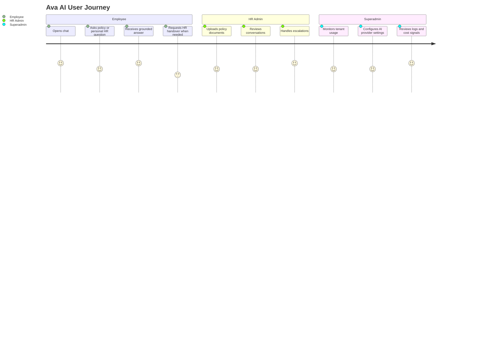

[Back to README](../README.md)

# 02 Business Problem

## Problem

HR teams receive repetitive employee questions across leave, payroll, benefits, claims, attendance, workplace conduct, onboarding, resignation, and policy interpretation. Employees expect quick answers, but HR policies are often distributed across handbooks, documents, HRIS records, and human knowledge.

The risk is two-sided:

| Stakeholder | Pain Point |
| --- | --- |
| Employees | Slow response times and uncertainty about policy details |
| HR admins | Repeated support workload and limited visibility into common questions |
| Organizations | Compliance, confidentiality, and inconsistent answer risk |
| Platform operators | Need to control AI spend, provider settings, and tenant usage |

## Why Traditional FAQ Search Is Not Enough

Static FAQ search works when questions match known phrasing. HR support is messier. Employees ask incomplete, personal, multilingual, or emotionally sensitive questions. Answers may depend on company policy, employee status, live leave balance, payroll records, or whether HR should intervene.

Ava AI therefore uses a blended approach:

- Retrieve approved policy excerpts for policy questions.
- Query HRIS data for personal employee facts.
- Keep usage and tenant scope explicit.
- Offer HR handover when the assistant cannot answer safely.

## Success Criteria

| Goal | Success Signal |
| --- | --- |
| Faster support | Employees can ask common HR questions directly in chat |
| Safer AI | Answers are grounded in documents or live HRIS data |
| Better HR visibility | Admins can review conversations and escalations |
| Operational control | Superadmins can monitor usage, credits, logs, and AI settings |
| Portfolio clarity | The system can be explained through architecture and decisions without exposing code |

## User Journey

## Screenshot

The employee chat welcome state reduces the blank-page problem and guides employees toward appropriate HR use cases.
