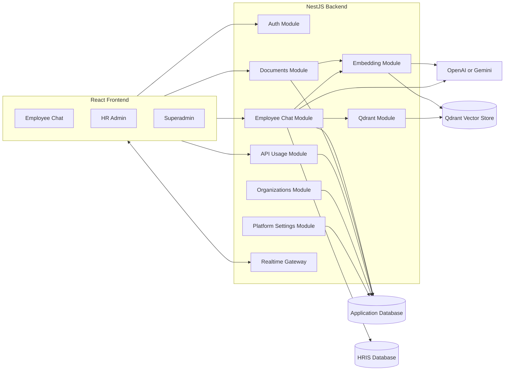

[Back to README](../README.md)

# 03 System Architecture

## Architecture Summary

Ava AI uses a role-based web application backed by a modular NestJS API. The backend coordinates authentication, chat sessions, document ingestion, retrieval, AI generation, HRIS data access, usage governance, and realtime events.

## Role Boundaries

| Role | Primary Surface | Responsibilities |
| --- | --- | --- |
| Employee | Chat console | Ask HR questions, review history, request handover |
| HR admin | Admin console | Upload documents, review chats, respond to escalations, view employees |
| Superadmin | Platform console | Manage organizations, usage, credits, AI settings, logs |

## Data Flow

1. The frontend sends authenticated API requests based on the current role.
2. The backend resolves user identity, organization, and HRIS context.
3. Chat questions are routed through deterministic checks, HRIS lookups, retrieval, or AI generation.
4. Messages, usage records, and session state are persisted.
5. Socket.IO events update employee and admin consoles in realtime.

## Design Principles

- **Scope first:** Every retrieval and admin view is scoped by organization or HRIS company.
- **Use the right source:** HRIS data answers personal facts; documents answer policy context.
- **Stop safely:** Escalation exists when the assistant cannot provide a reliable answer.
- **Operate visibly:** Usage, credits, logs, and settings make AI behavior governable.

## Screenshot

The HR admin dashboard shows the operational layer around the assistant and proves the product is more than a chat UI.
