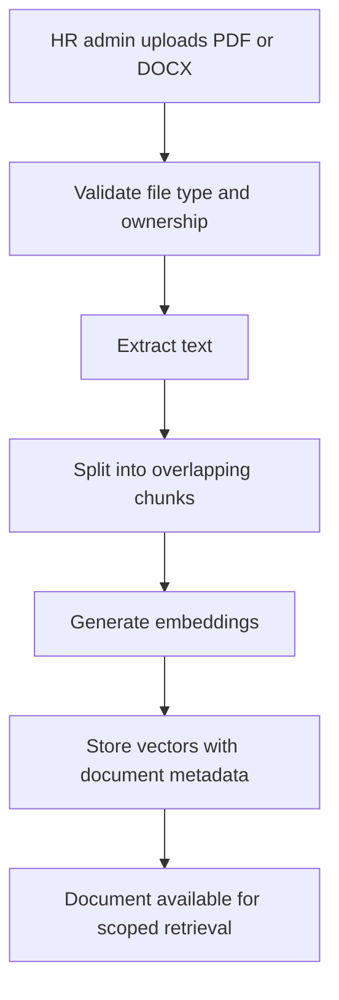
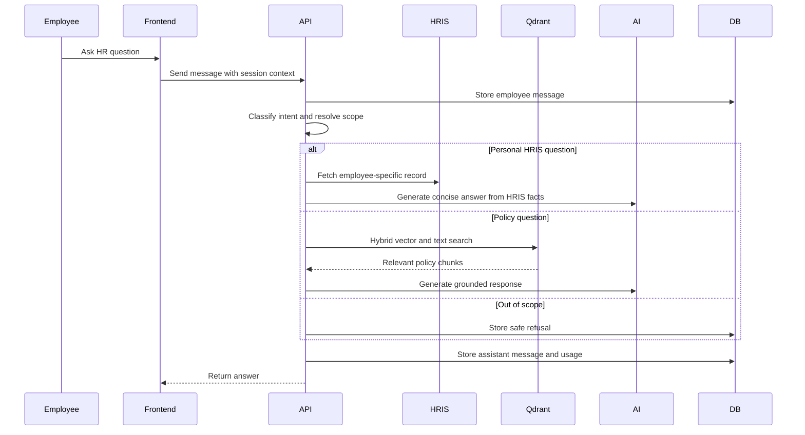
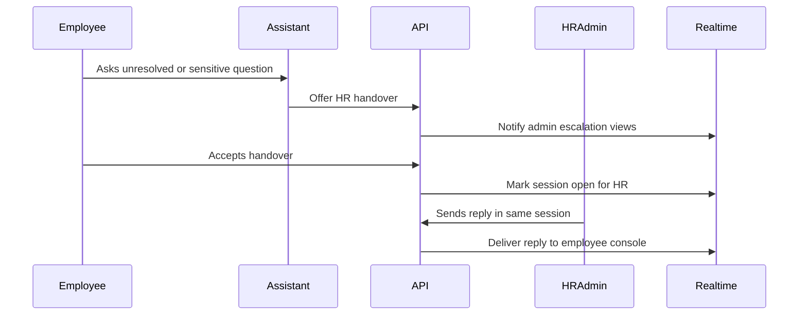
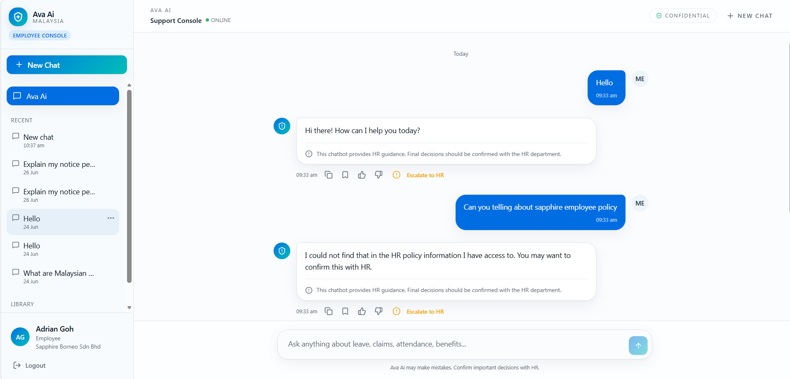

[Back to README](../README.md)

# 04 AI Workflow

## Workflow Summary

Ava AI uses retrieval-augmented generation for policy answers and live HRIS queries for employee-specific facts. This separation is the core safety decision: the model should explain and synthesize, but the system should decide which sources are trusted.

## Document Ingestion

Key characteristics:

| Step | Purpose |
| --- | --- |
| Validation | Prevent unsupported or oversized files from entering the workflow |
| Chunking | Keep retrieval units small enough for relevant context |
| Embedding | Convert policy text into searchable vector representations |
| Metadata | Preserve document, category, owner, organization, and HRIS company scope |

## Employee Question Flow

## Handover Flow

## Provider Strategy

Ava AI abstracts AI providers behind chat and embedding services. The platform can use OpenAI or Gemini based on settings, while usage attribution remains consistent.

| Decision | Benefit |
| --- | --- |
| Provider abstraction | Reduces lock-in and supports operational switching |
| Usage attribution | Makes cost and credit controls enforceable |
| Temporary-unavailable handling | Gives users a clear fallback when providers fail |
| Development embedding override | Supports local testing without relying on production providers |

## Screenshot

This employee chat example demonstrates the central AI value proposition: a practical HR answer in a confidential assistant interface.
