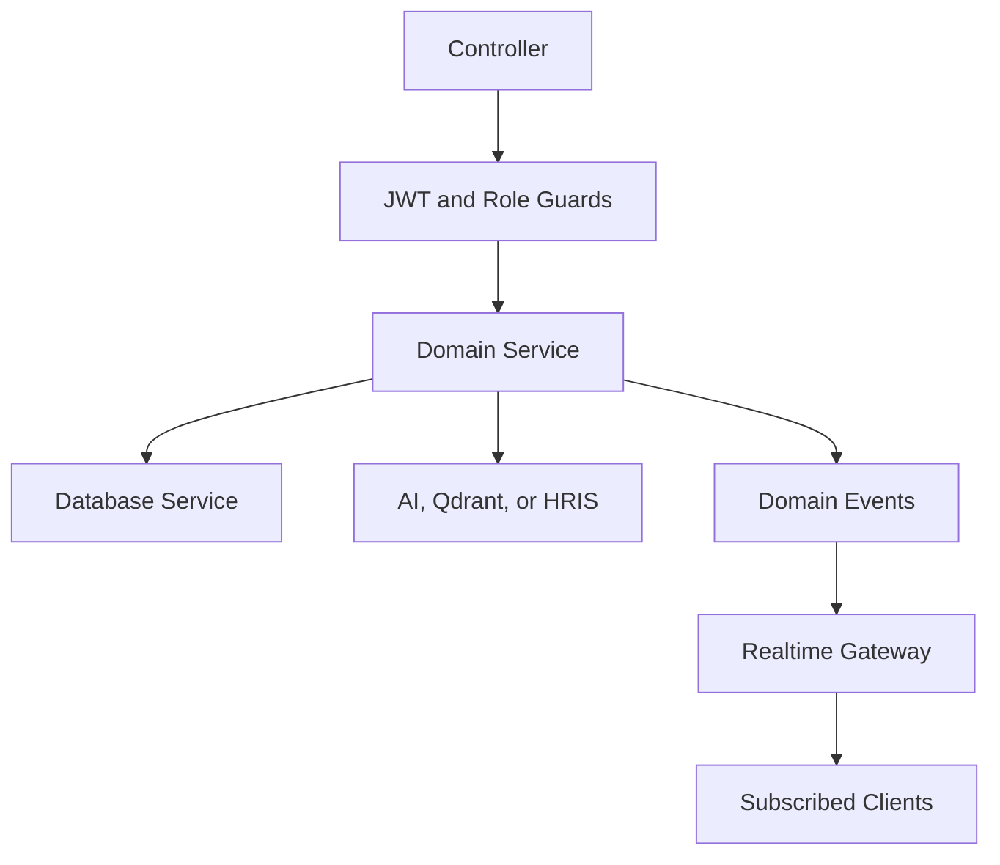

[Back to README](../README.md)

# 05 Backend Design

## Backend Summary

The backend is a modular NestJS application. Each module owns a clear operational concern: identity, chat, documents, retrieval, AI usage, platform settings, organizations, database access, and realtime events.

## Module Responsibilities

| Module | Responsibility |
| --- | --- |
| Auth | JWT auth, HRIS session support, current-user context, role guards |
| Employee Chat | Sessions, messages, HRIS-aware answers, handover, admin replies |
| Documents | Upload, list, delete, reindex, document ownership |
| Document Indexing | Chunk text, embed content, write vectors, search policy context |
| Embedding | OpenAI/Gemini/Ollama embedding strategy and usage recording |
| Qdrant | Vector collection access, search, delete, payload filtering |
| API Usage | Credit checks, token tracking, summary dashboards, request logs |
| Platform Settings | AI provider, model, temperature, and platform-level settings |
| Organizations | Tenant overview and AI credit management |
| Realtime | Socket.IO events for chat, sessions, and escalations |

## Backend Flow

## Important Design Choices

| Choice | Reason |
| --- | --- |
| Service-oriented modules | Keeps AI, documents, usage, and auth independently understandable |
| Role guards | Protects HR admin and superadmin-only workflows |
| Event-driven realtime updates | Avoids polling for chat and escalation changes |
| Usage checks before AI calls | Prevents uncontrolled cost growth |
| HRIS pool isolation | Keeps external HRIS access explicit and separable |

## Screenshot

The escalation view shows backend handover state becoming a practical HR workflow.
