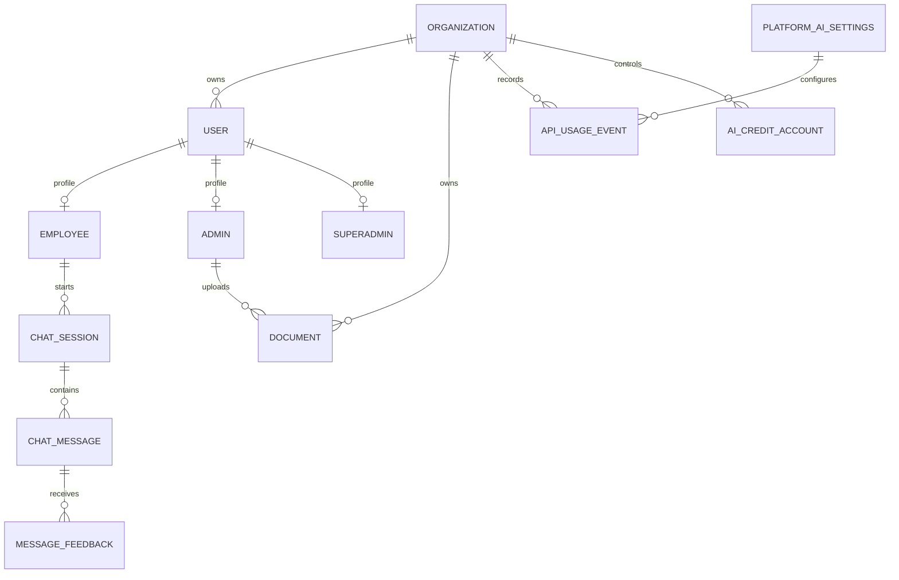
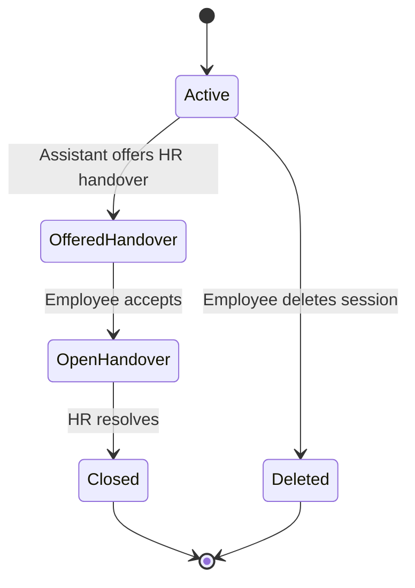
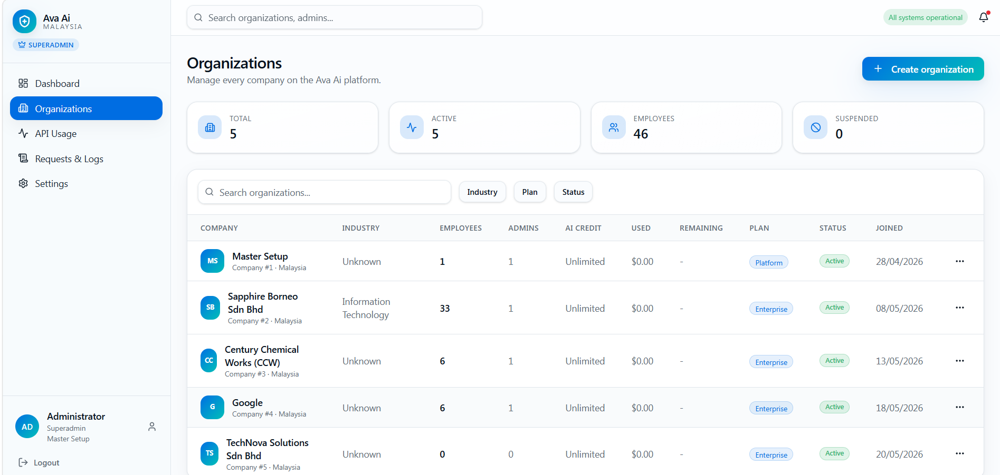

[Back to README](../README.md)

# 06 Database Design

## Data Model Summary

Ava AI combines tenant identity, users, HR roles, chat history, document metadata, usage tracking, platform settings, and HRIS session context. The application database stores product state; the HRIS database remains the source of truth for employee-specific operational records.

## Core ER Diagram

## Entity Groups

| Group | Examples | Purpose |
| --- | --- | --- |
| Tenant and identity | Organizations, users, employees, admins, superadmins | Model role boundaries and tenant ownership |
| HR operations | Leave balances, HR requests, escalations | Represent operational HR workflows |
| Chat | Sessions, messages, feedback, handover state | Preserve conversation history and escalation continuity |
| Documents | Uploaded documents and knowledge base metadata | Track source files and indexing lifecycle |
| Settings | Organization and global AI settings | Configure behavior, compliance, provider defaults |
| Monitoring | API usage, request logs, audit logs, credits | Support governance, cost control, and traceability |

## Tenancy And Scope

The database design supports both local organization users and HRIS-session users. Retrieval and admin views are scoped by organization or HRIS company identity so one tenant's documents and conversations do not leak into another tenant's context.

## State Diagram

## Screenshot

The organization management view explains the multi-tenant nature of the data model and governance workflow.
