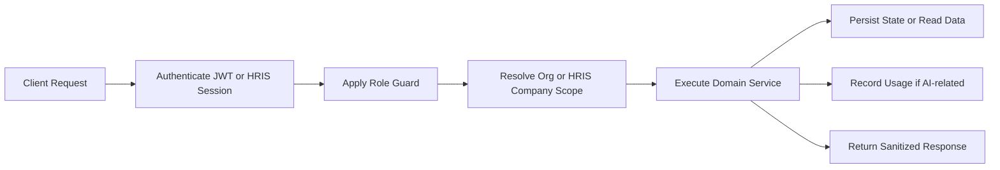

[Back to README](../README.md)

# 07 API Overview

## API Design Summary

The API is organized around product capabilities rather than technical implementation details. Authentication, role authorization, tenant scope, and usage governance are applied at the backend boundary.

> [!CAUTION]
> This page intentionally documents endpoint groups and responsibilities. It does not expose request bodies, secrets, private schema details, or source code.

## Endpoint Groups

| Area | Representative Capability |
| --- | --- |
| Auth | Register, login, HRIS session launch/callback, current user |
| Employee chat | Sessions, messages, handover request, delete session |
| Admin chat | View sessions, view messages, reply as HR, list escalations |
| Employees | List employees from local data or HRIS-scoped company data |
| Documents | Upload PDF/DOCX, list documents, reindex, delete |
| Organizations | List organizations, view/update AI credit state |
| Platform settings | Get and update AI provider/model/temperature settings |
| API usage | Summary, user usage, request logs |

## API Interaction Flow

## Design Notes

| Concern | Approach |
| --- | --- |
| Role safety | HR admin and superadmin workflows are guarded separately |
| Tenant isolation | Services receive resolved organization or HRIS company context |
| AI cost control | Usage checks happen before AI-dependent operations |
| Realtime UX | Chat-related state changes emit events after persistence |
| File safety | Document upload is limited to supported HR document formats |

## Screenshot Placeholder

**File:** `screenshots/super-logs.png`

Capture the logs or request activity view with sanitized demo users. This matters because it shows that platform behavior is auditable, not opaque.

> [!NOTE]
> This screenshot has not been added yet. Keep this placeholder until a sanitized logs view is available.
