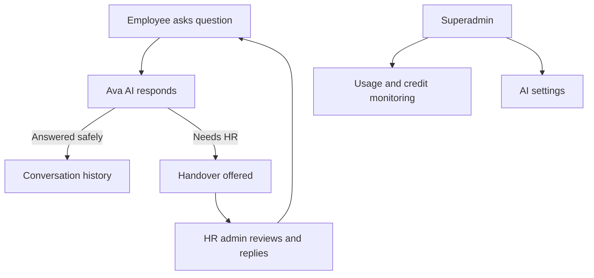

[Back to README](../README.md)

# 08 Feature Documentation

## Feature Map

| Role | Features |
| --- | --- |
| Employee | Chat, suggested prompts, history, HRIS-aware answers, HR handover |
| HR Admin | Dashboard, conversations, escalations, employees, documents |
| Superadmin | Overview, organizations, API usage, AI settings, request logs |

## Employee Assistant

Employees ask HR questions through a focused chat console. Suggested prompts guide users toward appropriate topics such as leave, overtime, medical leave, maternity policy, harassment, and resignation rights.

The assistant can answer:

- Policy questions from indexed documents.
- Personal HRIS questions such as profile, leave balance, payroll, and expenses.
- Basic conversational messages without invoking retrieval unnecessarily.
- Out-of-scope messages with a clear boundary.

## HR Admin Experience

HR admins can review conversations, inspect escalation sessions, upload policy documents, and view employee data. The admin experience turns AI support into an operational workflow rather than an isolated chatbot.

## Superadmin Experience

Superadmins manage platform-level concerns: organizations, AI credits, provider settings, usage trends, user-level usage, and logs. This makes the AI layer governable across tenants.

## Feature Workflow

## Screenshots

| Admin Conversations | Document Management |
| --- | --- |
|  |  |
| HR teams can review assistant conversations and inspect message context. | HR teams can manage the policy documents that ground assistant answers. |

## Remaining Screenshot Placeholder

| File | What To Capture | Why It Matters |
| --- | --- | --- |
| `screenshots/admin-employees.png` | Employee directory with demo data | Shows HRIS/local employee visibility |
