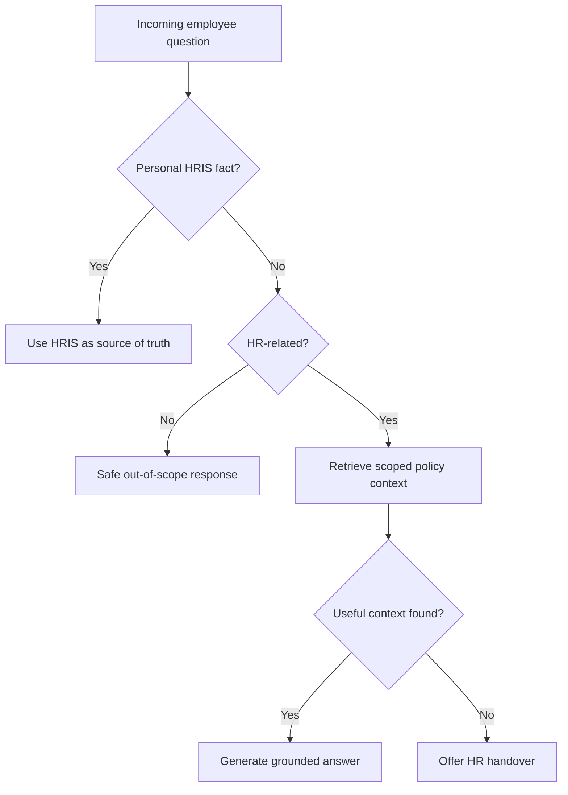
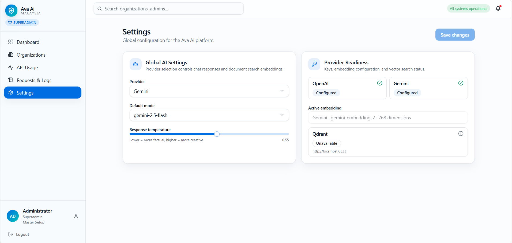

[Back to README](../README.md)

# 09 Engineering Decisions

## Decision Summary

Ava AI's architecture prioritizes safety, tenant scope, and operational control over a simpler chatbot implementation. The most important decisions are about boundaries: which data source to trust, which users can see which workflows, and when the AI should hand over to HR.

## Key Trade-offs

| Decision | Trade-off | Outcome |
| --- | --- | --- |
| RAG over static FAQ | More infrastructure, better contextual answers | Policy answers can adapt to uploaded company documents |
| Hybrid vector and text retrieval | More retrieval logic, better recall | Helps catch both semantic and keyword-heavy policy matches |
| OpenAI/Gemini abstraction | More provider code, less lock-in | Platform can switch providers through settings |
| HRIS-aware answer paths | More conditional routing, higher trust | Personal facts come from live systems, not model memory |
| Realtime handover | More state and event handling, better safety | HR can step into unresolved or sensitive conversations |
| Usage credits | More governance logic, lower cost risk | Organizations can be limited or paused predictably |

## Architecture Decision Record Style

### RAG Instead Of Fine-tuning

Fine-tuning would not solve document freshness or tenant-specific policy differences. RAG lets each organization upload policy documents and retrieve only the relevant context at answer time.

### Scoped Retrieval

Retrieval is filtered by organization or HRIS company context. This is essential in HR because a correct answer for one company may be wrong or confidential for another.

### Human Handover

The product assumes that AI should not be forced to answer every question. Handover is a design feature, not a failure state.

### Usage Governance

AI usage is treated as a metered platform resource. Recording provider, model, token usage, company attribution, and operation type enables cost monitoring and credit limits.

## Decision Diagram

## Screenshot

The AI settings page supports the provider abstraction and governance story.
