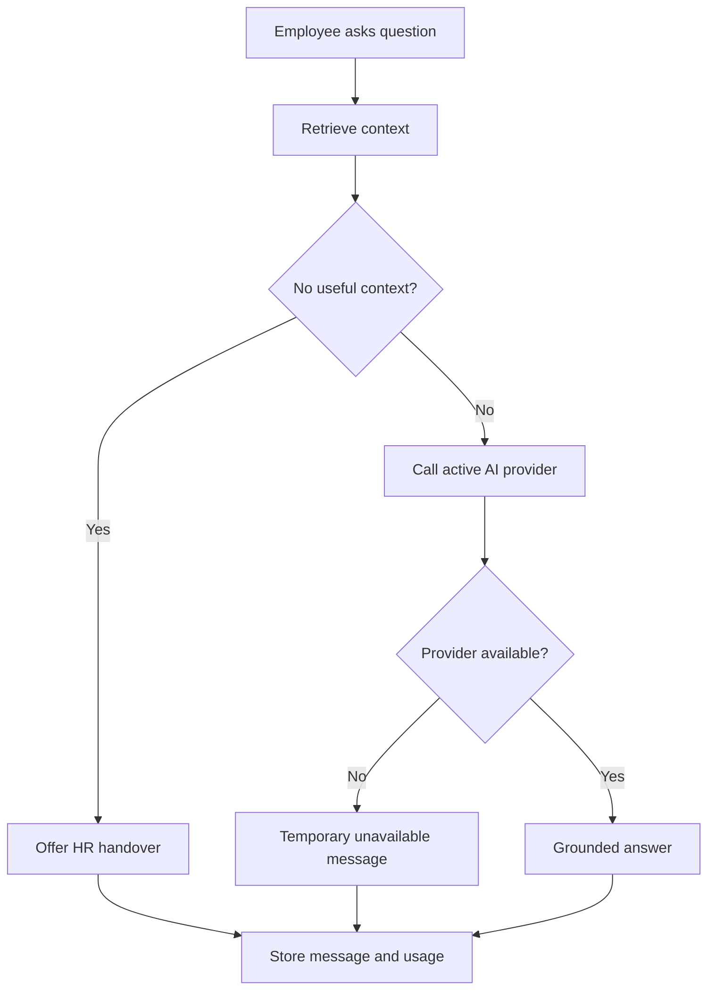
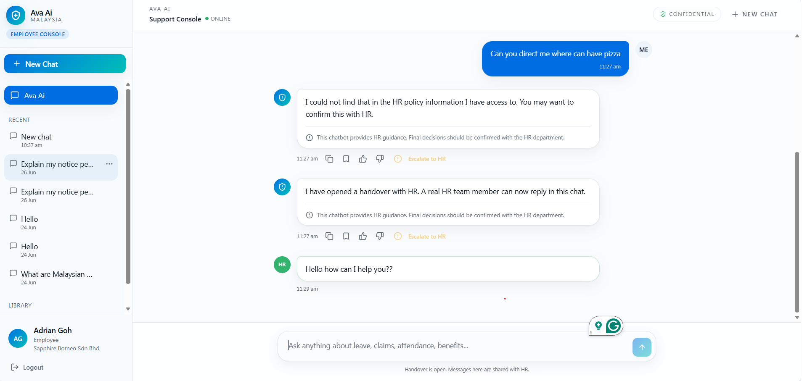

[Back to README](../README.md)

# 10 Challenges

## Challenge Summary

The hardest parts of Ava AI are not only model integration. The deeper challenges are trust, privacy, tenant isolation, retrieval quality, and graceful failure.

## Challenge Matrix

| Challenge | Risk | Mitigation |
| --- | --- | --- |
| Hallucinated HR policy | Incorrect employee guidance | Retrieval grounding, scoped context, fallback messages |
| Confidential data | Employee or company data exposure | Role guards, tenant scope, sanitized documentation |
| Mixed identity sources | Local users and HRIS sessions behave differently | Explicit owner keys, organization scope, HRIS company scope |
| Provider outages | Chat or embedding failures | Provider abstraction and temporary-unavailable responses |
| AI cost growth | Unbounded token and embedding usage | Credit checks, usage events, summary dashboards |
| Stale policy documents | Answers based on old content | Reindex workflow and document lifecycle states |
| UX trust | Employees may overtrust AI | Disclaimers, concise answers, HR handover path |

## Failure Mode Flow

## Lessons From The Challenges

- Sensitive domains need explicit uncertainty handling.
- Retrieval quality depends on metadata as much as embeddings.
- Admin workflows are essential for keeping AI systems accountable.
- Operational dashboards should be part of the product from the beginning.

## Screenshot

The handover state proves the product has a human-in-the-loop safety path.
