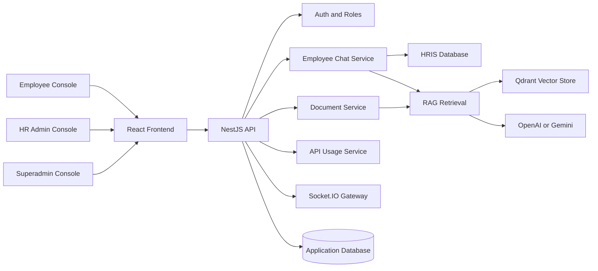
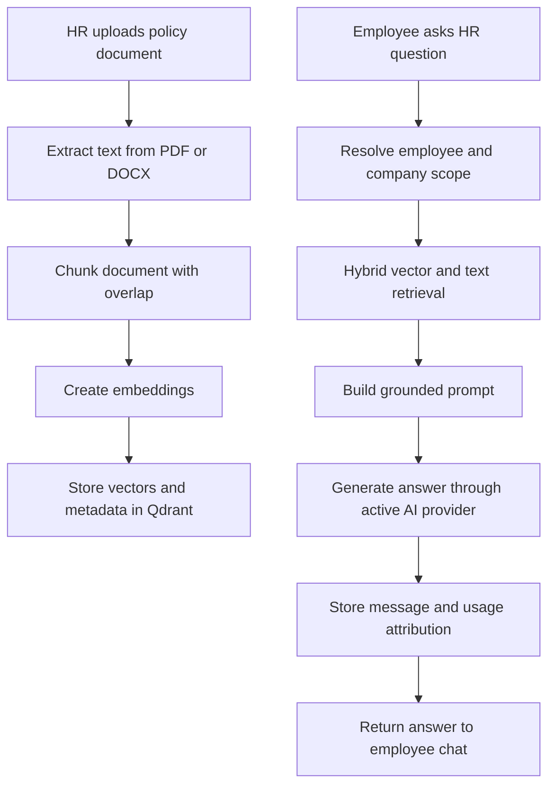
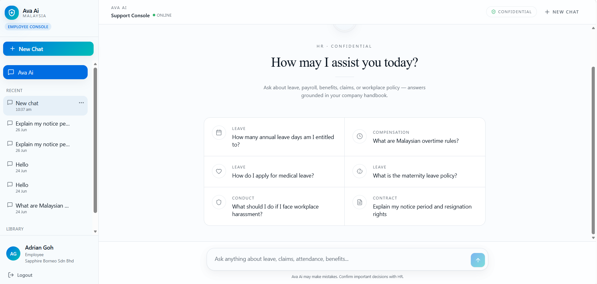
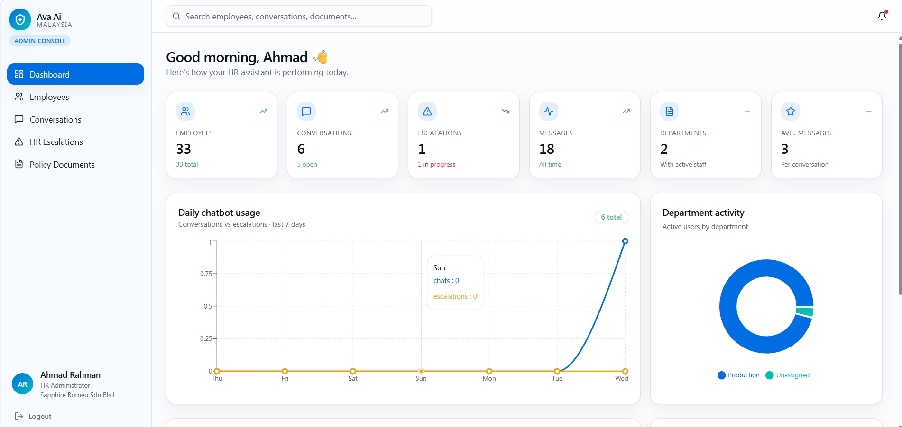
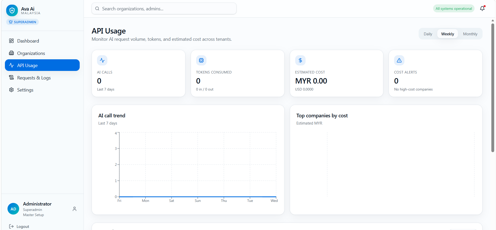
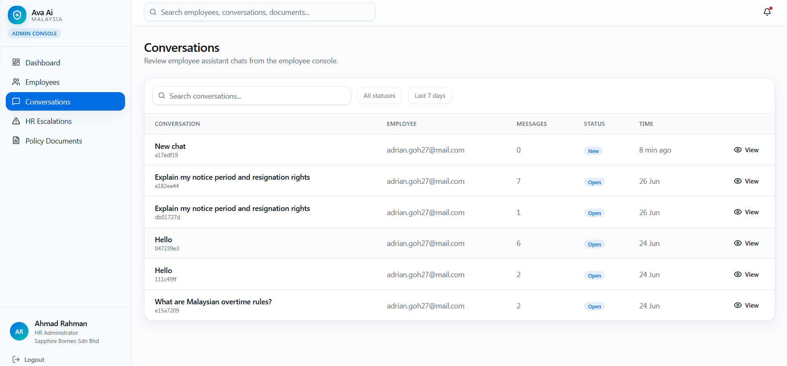
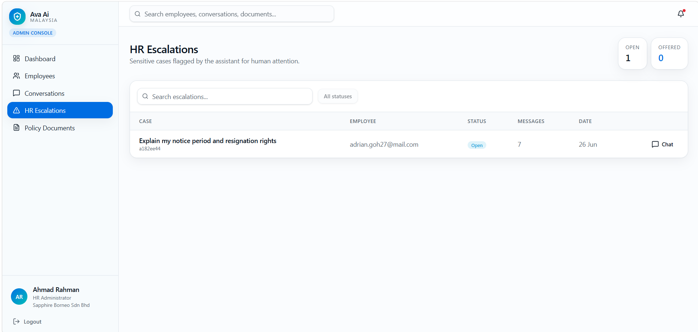
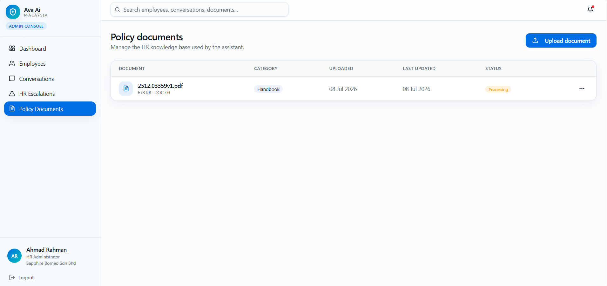

# Ava AI

> [!NOTE]
> This repository is a portfolio case study. It explains the architecture, engineering decisions, AI workflow, and product reasoning behind Ava AI without exposing proprietary source code, secrets, private HR data, or confidential implementation details.

| Context | Team | Status | My part |
| --- | --- | --- | --- |
| AI Engineering Internship, Apping Technology Sdn. Bhd. (2026) | Engineering team | Used by real users | [My contributions →](docs/11-my-contributions.md) |

## Overview

**Ava AI** is an AI-powered HR assistant that helps employees get fast, policy-aware answers about leave, payroll, benefits, claims, workplace conduct, and HR procedures. It combines document-grounded retrieval, HRIS-aware employee context, realtime HR handover, and platform-level usage governance.

The product was designed for a practical HR operations problem: employees need immediate support, while HR teams need visibility, control, and confidence that answers remain scoped to approved company knowledge.

<strong>Portfolio Snapshot</strong>

| Dimension | Summary |
| --- | --- |
| Product | Confidential HR assistant for employees and HR teams |
| Core AI Pattern | Retrieval-Augmented Generation with scoped company context |
| Users | Employees, HR admins, superadmins |
| Backend | Modular NestJS API with PostgreSQL-style persistence |
| Frontend | React, TanStack Router, React Query, Tailwind, Radix UI |
| AI Providers | OpenAI and Gemini abstraction for chat and embeddings |
| Retrieval | Qdrant vector store with hybrid vector and payload text search |
| Realtime | Socket.IO chat updates and HR handover events |
| Governance | AI credits, usage tracking, provider settings, request logs |

## Project Summary

Ava AI turns HR policy documents and HRIS records into a conversational support experience. Employees can ask natural-language questions, receive concise answers grounded in approved documents or live HRIS data, and escalate to HR when the system cannot answer safely.

For HR admins, Ava AI provides document management, conversation review, employee visibility, and escalation handling. For superadmins, it adds tenant-level controls, AI provider settings, usage analytics, and operational monitoring.

## Feature Highlights

| Area | Capability | Why It Matters |
| --- | --- | --- |
| Employee chat | Suggested prompts, message history, confidential assistant UX | Reduces HR support friction while keeping the experience approachable |
| RAG answers | Document ingestion, embeddings, scoped retrieval, grounded generation | Keeps answers aligned with approved company policy |
| HRIS-aware responses | Leave balance, payroll, expenses, employee profile context | Separates live personal data from static policy knowledge |
| HR handover | Assistant can offer escalation and HR can respond in the same thread | Preserves continuity when automation should stop |
| Admin review | Conversation tables, message drawer, escalations, employees | Gives HR operational visibility without exposing implementation internals |
| Superadmin controls | Organizations, AI credits, usage dashboards, settings, logs | Supports governance, cost control, and platform oversight |

## Technology Stack

| Layer | Technologies |
| --- | --- |
| Web app | React, Vite, TanStack Router, TanStack Query, Tailwind CSS, Radix UI |
| API | NestJS, TypeScript, JWT auth, role guards, Socket.IO, EventEmitter |
| Data | PostgreSQL-style relational schema, migrations, HRIS database integration |
| AI | OpenAI, Gemini, provider abstraction, token usage attribution |
| Retrieval | Qdrant, chunking, embeddings, hybrid vector and text search |
| Observability | Request logs, API usage summaries, AI credit tracking |

## Architecture Preview

[Read the full architecture](docs/03-system-architecture.md)

## AI Workflow Preview

[Read the full AI workflow](docs/04-ai-workflow.md)

## Screenshot Gallery

Screenshots are captured with sanitized demo data and selected to show the core product workflows.

| Employee Assistant | HR Admin Operations |
| --- | --- |
|  |  |
| Suggested prompts help employees start with common HR questions. | HR teams can monitor assistant activity, conversations, and escalations. |

| Grounded Answer | Platform Governance |
| --- | --- |
|  |  |
| Ava AI answers policy questions through scoped retrieval and clear trust cues. | Superadmins can monitor usage, credits, and operational trends. |

<strong>More Screenshots</strong>

| Workflow | Screenshot |
| --- | --- |
| HR handover |  |
| Admin conversations |  |
| Admin escalations |  |
| Admin documents |  |
| Superadmin organizations |  |
| Superadmin settings |  |

[View screenshot capture plan](screenshots/README.md)

## Documentation Navigation

| Document | What It Explains |
| --- | --- |
| [01 Executive Summary](docs/01-executive-summary.md) | Product, architecture, and portfolio value in one page |
| [02 Business Problem](docs/02-business-problem.md) | Why Ava AI exists and what problem it solves |
| [03 System Architecture](docs/03-system-architecture.md) | Components, boundaries, data flow, and roles |
| [04 AI Workflow](docs/04-ai-workflow.md) | RAG, HRIS-aware answers, provider abstraction, handover |
| [05 Backend Design](docs/05-backend.md) | NestJS modules, service responsibilities, realtime events |
| [06 Database Design](docs/06-database.md) | Entity model, tenancy, chat, documents, usage governance |
| [07 API Overview](docs/07-api.md) | Endpoint groups and API design principles |
| [08 Feature Documentation](docs/08-key-features.md) | User-facing features by role |
| [09 Engineering Decisions](docs/09-engineering-decisions.md) | Trade-offs and architectural reasoning |
| [10 Challenges](docs/10-challenges.md) | Technical risks and how they were managed |
| [11 My Contributions](docs/11-my-contributions.md) | Engineering contribution narrative |
| [12 Future Work](docs/12-future-work.md) | Roadmap and next technical improvements |
| [Appendix](docs/appendix.md) | Glossary, privacy notes, and review checklist |
| [Diagram Plan](diagrams/README.md) | Diagram inventory and export guidance |
| [Screenshot Plan](screenshots/README.md) | Capture list and privacy guidance |

## Key Achievements

- Designed a multi-role AI HR assistant spanning employees, HR admins, and superadmins.
- Implemented a RAG workflow that scopes answers by organization or HRIS company context.
- Added provider abstraction so chat and embedding workflows can operate with OpenAI or Gemini.
- Combined document retrieval with live HRIS data for leave, payroll, expense, and profile questions.
- Added realtime HR handover so sensitive or unanswered cases can move from AI to human support.
- Built platform governance through usage tracking, AI credits, request logs, and provider settings.

## Limitations

What this case study does not show, and what the system does not yet do:

- Source code, HR documents and employee data are private, so answer quality is described qualitatively here.
- There is no automated regression suite for RAG quality and hallucination behaviour yet.
- Answers do not yet show the exact source excerpt and document link they were grounded in.
- Policy documents have no versioning or effective dates; stale content relies on the reindex workflow.
- Bahasa Malaysia and mixed-language answers need further work.
- Enterprise single sign-on (SSO/SAML/OIDC) is not supported yet.

## Lessons Learned

> [!IMPORTANT]
> HR assistants need trust boundaries as much as they need intelligence. The strongest design decisions in Ava AI separate what the model can infer, what the system must retrieve, and when a human should take over.

- RAG is most valuable when retrieval is scoped, auditable, and connected to a clear fallback path.
- Live HRIS data should be treated as a source of truth for personal facts, not blended casually with policy excerpts.
- Cost governance belongs in the product architecture, not as an afterthought.
- Realtime handover makes AI support safer because it gives the system a graceful way to stop.

---

**Part of [Bakary Gibba's AI engineering portfolio](https://github.com/BakaryGibba/bakary-gibba-ai-engineering-portfolio)**

[Portfolio website](https://bakary-gibba.vercel.app/) · [LinkedIn](https://www.linkedin.com/in/bakary-gibba-6409bb248/) · [Google Scholar](https://scholar.google.com/citations?user=bp0G4sgAAAAJ&hl=en)

