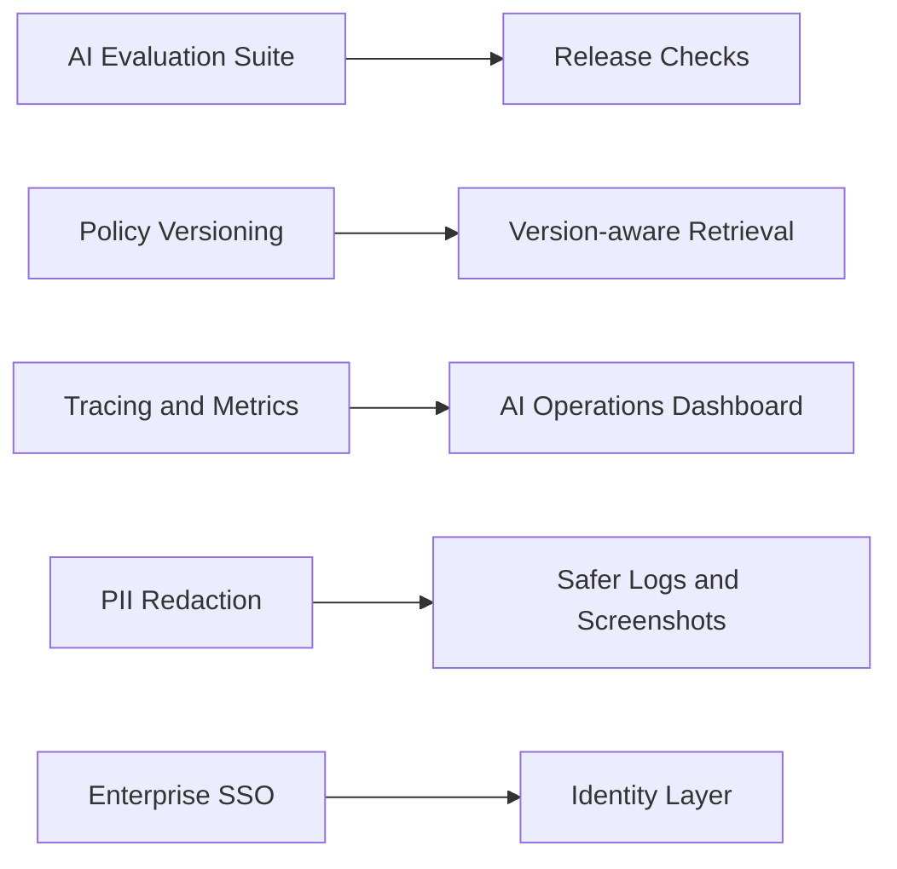

[Back to README](../README.md)

# 12 Future Work

## Roadmap Summary

Future improvements should strengthen trust, evaluation, observability, enterprise readiness, and multilingual HR support.

## Recommended Improvements

| Area | Improvement | Expected Benefit |
| --- | --- | --- |
| Citations | Show exact source excerpts and document links in answers | Improves trust and auditability |
| Evaluation | Add regression tests for RAG quality and hallucination behavior | Makes AI changes safer |
| Analytics | Build dashboards for topic trends, unanswered questions, and escalation drivers | Helps HR improve policies |
| Policy lifecycle | Add versioning, archival, and effective dates for documents | Prevents stale policy answers |
| Redaction | Automatically detect and mask sensitive content in logs and screenshots | Improves privacy posture |
| Enterprise auth | Add SSO/SAML/OIDC support | Fits larger organization deployment |
| Observability | Add tracing across retrieval, AI calls, and realtime events | Speeds debugging and monitoring |
| Multilingual support | Improve Bahasa Malaysia and mixed-language HR answers | Better local employee experience |

## Future Architecture Direction

## Prioritization

1. Add answer citations and policy source previews.
2. Add AI evaluation datasets for common HR questions.
3. Add observability across retrieval, generation, and handover.
4. Add document versioning and effective-date filtering.
5. Add enterprise identity integrations.
